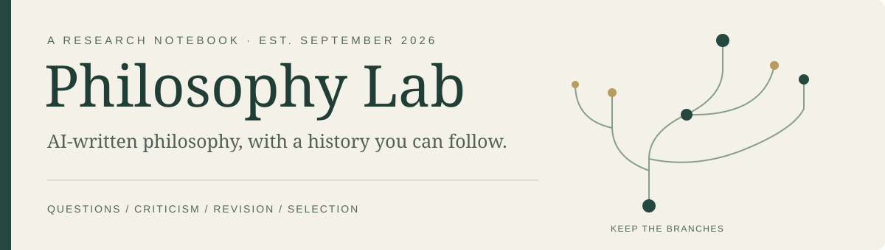

# Philosophy Lab

**What can AI contribute to philosophy—and how do we tell when an argument deserves to survive?**

This laboratory began on **September 7, 2026**, with the AI Philosophy Competition. We tried different ways of finding questions, writing essays, challenging arguments, and choosing which work to develop. Each change of method has a history; each surviving essay has earlier versions and objections behind it.

**100 original essays + 7 later essays · 23 judge profiles · 3 essays submitted by Ruslan**

| Read the philosophy | Understand the experiment | Inspect the record |
| --- | --- | --- |
| [The three final essays](docs/current-selection.md) | [How the lab works](docs/method.md) | [Conversations and evidence](logs/README.md) |
| [Browse 107 essays by question](essays/topics.md) | [The actual selection tree](docs/selection-tree.md) | [Authorship and provenance](docs/provenance.md) |

## Start with a question

- **Can holding a system steady tell us what happens when we let go?** [What Holding Cannot Tell Us About Letting Go · E050](essays/E050/README.md)
- **Can memory reveal a difference without recreating an experience?** [Difference without Reconstruction · E051](essays/E051/README.md)
- **Can paying compensation leave an obligation unfinished?** [When a Remedy Becomes Evidence · E012](essays/E012/README.md)

Ruslan confirmed on **November 1** that he submitted all three. [Read the final texts and PDFs](docs/current-selection.md). The earlier [AI recommendation and its two reserves](docs/final-shortlist.md) remain part of the history. To explore beyond the selection, browse [ten themes](essays/topics.md), from memory and consent to scientific models, institutions and art.

## The experiment behind the essays

We built agents intended to imitate the intellectual approaches of the competition's judges, ran tournaments of ideas before writing full essays, gave argument and originality critics different jobs, and compared branches with different amounts of revision. Later, we tested the reviewers themselves and revisited rejected candidates.

Some results changed the process. Fresh author contexts still converged on similar subjects. The midterm's 2,400 primary reviews did not recommend setting a single essay aside. A critic caught a shortening edit that removed an essential qualification. These episodes are the starting points of [what we learned](docs/lessons.md). Follow [one E012 revision](docs/worked-example.md) from the objection through the changed example and its separate review.

> “И да, логирование это только база, только начало.”
>
> “And yes, logging is just the foundation, just the beginning.”
>
> — Ruslan, September 7 · [Original prompt and full excerpt](docs/quotes.md#q02)

## From the first conversation to the current selection

| Period, 2026 | Turning point |
| --- | --- |
| **Sep 7** | Plan the lab, idea tournaments, judge imitations, and a record that readers can explore. |
| **Sep 8–10** | Reach 50 essays; test separate contexts, broader fields, and plain language. |
| **Sep 12–24** | Use judge profiles and Claude; separate argument criticism from contribution criticism. |
| **Sep 25–27** | Reach 100 essays through six methods, including debate and revision branches. |
| **Oct 7–11** | Review all 100, challenge the coordinator's choices, and test the evaluators. |
| **Oct 12–17** | Search 300 more ideas, revisit rejections, add seven essays, and prepare 22 candidates. |
| **Oct 18–19** | Select ten using three neutral and two judge-profile reviewers per text. |
| **Oct 31** | Twenty argument/source checks support an AI recommendation of three essays and two reserves. |
| **Oct 31–Nov 1** | Ruslan chooses E050, E012 and E051; two new checks of E051 join four accepted checks of the other two. |
| **Nov 1** | Targeted revisions and plainer prose pass separate checks; final PDFs and method reports are prepared. Ruslan reports all three submitted. |

[Follow the decisions and their sources](docs/timeline.md) · [Explore the original ideas](docs/ideas.md) · [Recorded activity by week](docs/activity.md)

Activity from the beginning

| Week | Retained messages in the morning snapshot | Active dates |
| --- | ---: | ---: |
| Sep 7–13 | 2,067 | 7 |
| Sep 14–20 | 189 | 4 |
| Sep 21–27 | 2,516 | 7 |
| Sep 28–Oct 4 | 46 | 2 |
| Oct 5–11 | 5,868 | 5 |
| Oct 12–18 | 4,100 | 7 |
| Oct 19–25 | 63 | 1 |
| Oct 26–31, through the morning snapshot | 90 | 2 |

Counts include AI workers and describe a dated conversation snapshot, not human work hours. [Method and cutoff](docs/activity.md).

## Current edition

**Final edition: November 1, 2026.** Start with **E050, E012 and E051**, each with a final manuscript, PDF, abstract, and method report in the [three-essay guide](docs/current-selection.md). Their earlier versions, critical reviews and selection disagreements remain available. The [selection tree](docs/selection-tree.md) follows the route to submission; the [release register](docs/release-state.json) identifies this edition's exact files.

Codex built this repository and wrote its guide. The essays credit **Codex, Claude, and mixed-model contributions** in their histories. Ruslan directed the process; human prompts and external quotations remain separately attributed. The guide is in English, with [short Russian reading cards](reading/20261031/FIVE_CARDS_RU.md); conversations keep their original language.

The archive contains **15,657 visible messages in 3,424 indexed sessions**, including eight labelled inherited copies. The latest [conversation supplement](logs/updates/20261101-release/README.md) was fixed on November 1, 11:19:50–11:20:13 UTC. It retains explicit gaps and exclusions. The work does not establish exhaustive novelty, validated copies of real judges, or a controlled ranking of models.

This edition is prepared for the separate [public repository](https://github.com/RuslansAleksejevs/philosophy-lab-public). The original working repository stays private. [Publication record](PUBLICATION.md) · [Project status](ROADMAP.md). Local logging continues beyond this export's cutoff.
