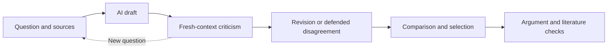

[Home](../README.md) · [Read](current-selection.md) · [Method](method.md) · [History](timeline.md) · [Archive](../logs/README.md)

# How the lab works

The lab has two connected aims: produce worthwhile philosophical arguments, and learn how to find and assess them. The competition gave the work a concrete destination. The process developed through experiments, criticism, and corrections.

## One essay, several jobs

This is a guide to the recurring cycle, not a claim that every branch followed it. Some essays used self-review; others had two kinds of critic or several revision branches. [Actual methods and exceptions](generation.md).

**The human** chose goals, resources, process and style, and sometimes expressed candidate preferences. **AI authors** developed the philosophical content. **Critics** challenged the supplied material in separate contexts. **The coordinator** compared completed results and explained decisions. Sources, human contributions, and mixed AI lineages keep their own labels. [Authorship and context boundaries](provenance.md).

## Why create agents in the judges' image?

The original ambition was to imitate the actual competition judges closely enough to rehearse criticism and internal selection. Profiles drew on accessible publications and public statements. Each fresh reviewing session received a manuscript, a rubric, and one profile.

The library grew from 16 to **23 profiles**. These were instructions and source packets, not separately trained model weights. We checked some predictions against published criticism and later tested error detection. Accurate imitation of the real judges was an objective, not an established result. [The judge experiment](judges.md).

## The selection was a branching process

Nine midterm candidates, six conditional returns and seven later essays formed the twenty-two-text comparison. Ten received reading places and then twenty deeper checks. The AI coordinator recommended three with two reserves; Ruslan subsequently chose E050, E012 and E051, bringing E051 back from outside that pool.

The [selection tree](selection-tree.md) names every member of the later stages, keeps the rejected branches visible, and separates the human choice from the AI recommendation. The 300-attempt search produced one tentative seed; it did not produce 300 essays. [Later programs](post-midterm.md).

For the 22 → 10 selection, three neutral and two judge-profile reviews preserved the agreed **60/40 balance**. The completed package contains 110 individual reviews and 50 reviews of disputed pairs. Scores guided inspection; checked objections and comparative reasons determined the coordinator's choices. [All 22 decisions](selection.md).

The October 31 checks were a separate stage: one argument review and one literature/source review per frozen text. They informed the [3+2 recommendation](final-shortlist.md), without rewriting the manuscripts.

For a concrete manuscript-level example, follow [E012: objection, repair, fresh check and selection](worked-example.md).

## Read further

- [Ideas that shaped the project](ideas.md): the original ambitions and what was actually built.
- [What we learned](lessons.md): concrete cases, useful implications, and unresolved questions.
- [A working history](timeline.md): why the method changed.
- [Detailed method index](methodology-index.md): the historical 121-topic retrospective and later updates.
- [Evidence guide](../evidence/README.md): exact records behind the account.
